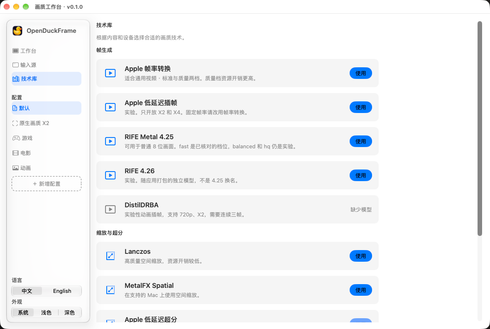

<p align="center"></p>
<h1 align="center">OpenDuckFrame</h1>
<p align="center"><b>Real-time frame generation and upscaling for your Mac.</b></p>
<p align="center">Choose a window, a display, or a video. Make it smoother. Make it clearer.</p>
<p align="center"><a href="https://openduckframe.cn/en/">Official website</a> · <b>English</b> · <a href="README.zh-CN.md">简体中文</a></p>
<p align="center">Apple silicon · macOS 14+ · <a href="LICENSE">MIT</a></p>

The default frame-generation model is **ODF-VFI**, a four-stage model derived from RIFE 4.25. Existing RIFE 4.25 profiles remain compatible; the app validates the actual four-stage weights when loading. Visual results remain content-dependent.

## About

OpenDuckFrame is a native Mac app that enhances the picture you are already watching.
Select a browser window, game or stream, a display, or a local video file, then
control frame generation and upscaling from one workbench. Processing happens on
your Mac, without an account or uploading your picture.

- **Frame generation.** Choose Apple interpolation or RIFE 4.25 / 4.26, select a
  target frame rate or X2 / X3 / X4, and watch the actual output rate.
  Availability and achieved performance depend on the engine, source and Mac.
- **Upscaling, independently.** Use Lanczos or MetalFX, or try the supported
  Apple and animation-oriented backends. Scaling and frame generation can be
  configured separately.
- **A workbench for everyday use.** Save profiles for games, films and animation;
  compare original and enhanced output; follow the source window or use a
  fullscreen output display.
- **A local video player, too.** Open formats including MKV, MP4, MOV and WebM,
  with subtitles, HDR playback on compatible displays, playback resume, speed
  control, and Finder Quick Look previews.
- **On-device subtitles.** Generate, translate and export text subtitles on
  supported macOS versions. macOS may download its language models first.
- **Private by design.** No account, ads, or playback analytics. See [PRIVACY.md](PRIVACY.md).

The player has 17 interface languages; the enhancement workbench supports Chinese
and English. Experimental backends and constraints are described in [the feature guide](docs/features.md).

<p align="center"></p>

## Get started

Download the [Mac app](https://github.com/Jun-bao/OpenDuckFrame/releases/latest/download/OpenDuckFrame.dmg)
or [browse releases](https://github.com/Jun-bao/OpenDuckFrame/releases).
The community download is ad-hoc signed and **not Apple notarized**, so macOS may
block its first launch. Only allow it in System Settings → Privacy & Security if
you trust the source. Apple silicon and macOS 14+ are required.

The app checks for signed updates and lets you choose when to install them.
You can also use **OpenDuckFrame → Check for Updates**, or disable automatic
checks from the same menu. Updating never uploads your media.

1. Open **File → Quality Workbench** (⇧⌘E).
2. Choose a window, display, or video file. macOS asks for Screen Recording
   permission when you capture a window or display.
3. Choose frame generation, upscaling, or both, and press **Start enhancement**.
4. Use the original / enhanced / comparison controls and FPS display to check the result.

See [Quick start](docs/quick-start.md) for permissions and troubleshooting.

## Requirements

| Capability | Requirements |
|---|---|
| App and local playback | Apple silicon Mac, macOS 14 or later |
| Window / display capture | Screen Recording permission; protected content may not be capturable |
| Apple frame generation and Apple super resolution | macOS 26+, supported hardware and input formats |
| RIFE frame generation | Apple silicon; throughput depends on resolution, quality and display rate |
| Subtitle generation and translation | macOS 26+ and an available system language model |
| Experimental animation backends | Additional models / runtimes; see [features](docs/features.md) |

Intel Macs, Windows, iPhone and iPad are not currently supported. A multiplier is
a requested processing mode, not a guarantee of a particular displayed frame rate.

## Build from source

Use an Apple silicon Mac with Xcode and the macOS 26.4 SDK or later, Python 3,
and these build tools:

```sh
brew install xcodegen meson ninja cmake pkg-config
git clone https://github.com/Jun-bao/OpenDuckFrame.git
cd OpenDuckFrame
./Apps/Mac/Scripts/build.sh Debug
open .build/Build/Products/Debug/OpenDuckFrame.app
```

For an optimized local build:

```sh
./Apps/Mac/Scripts/build.sh Release
```

The build fetches pinned dependencies, generates the Xcode project, bundles runtime
libraries and verifies the application. Debug output stays under `.build/`; Release
also publishes a local `OpenDuckFrame.app` at the repository root. Local builds use
ad-hoc signing. Developer ID signing, notarization and App Store packaging have
their own [release workflow](RELEASING.md).

RifeMetal is prepared from a pinned source archive with the local stream IO
patch before project generation. See [the runtime recipe](ThirdParty/rife-metal/README.md)
for provenance, licenses and the generated package boundary.

Edit [`Apps/Mac/project.yml`](Apps/Mac/project.yml), not the generated Xcode project.
Optional experimental runtimes are not built by default; see [the feature guide](docs/features.md#optional-runtimes).

## Repository

```text
Apps/Mac/          Native UI, live capture, resources, Quick Look and build definition
Modules/           Media playback, video enhancement and subtitle source
Platform/macOS/    Mac rendering and audio implementations
Scripts/           Build, verification, localization and release tools
ThirdParty/        Dependency lock, selected source and license notices
Design/            App icon source and deterministic exports
Website/           Static website source
docs/              Getting started, features and project documentation
```

These are source boundaries, not independently released packages. See
[REPOSITORY_LAYOUT.md](REPOSITORY_LAYOUT.md) for compilation and ownership details.
Generated projects, apps, dependency builds, private keys, local logs and test media stay outside Git.

## Community and contributing

Use [Issues](https://github.com/Jun-bao/OpenDuckFrame/issues) for bugs and
feature requests, and [Discussions](https://github.com/Jun-bao/OpenDuckFrame/discussions)
for questions and setup sharing. Include app and macOS versions, Mac model, source
resolution, engine and observed output rate. Review logs and screenshots for private content before sharing.

[CONTRIBUTING.md](CONTRIBUTING.md) covers development and checks;
[SECURITY.md](SECURITY.md) explains private vulnerability reporting.
See [CHANGELOG.md](CHANGELOG.md) for changes.

## License and acknowledgments

OpenDuckFrame's own code is [MIT-licensed](LICENSE). It builds on
[Khua Player](https://github.com/nake13/khuaplayer) and preserves its copyright notice.
FFmpeg, RIFE, model weights and other dependencies retain their own licenses;
see [THIRD_PARTY_NOTICES.md](THIRD_PARTY_NOTICES.md).
See [TRADEMARK.md](TRADEMARK.md) for the project name and icon.
