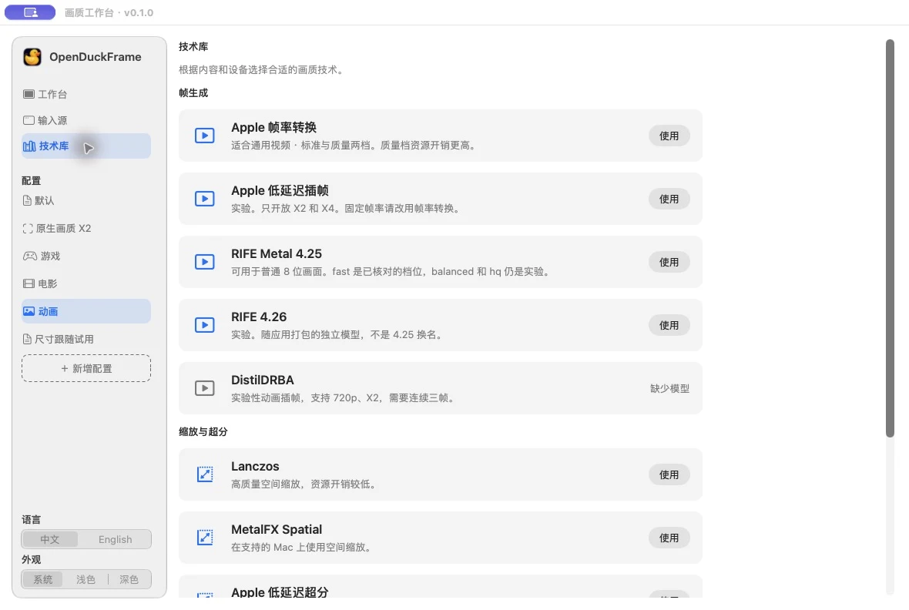

<p align="center"></p>
<h1 align="center">OpenDuckFrame · 开源小鸭</h1>
<p align="center"><b>让 Mac 上的画面更流畅、更清晰。</b></p>
<p align="center">选一个窗口、一块屏幕或一个视频，实时补帧与超分。</p>
<p align="center"><a href="README.md">English</a> · <b>简体中文</b></p>
<p align="center">Apple 芯片 · macOS 14+ · <a href="LICENSE">MIT 开源</a></p>

## 简介

OpenDuckFrame 是一款原生 Mac 画质增强应用。浏览器视频、游戏与串流窗口、整块显示器，或本地视频文件，
都可以作为输入源，在同一个工作台里配置补帧和超分。画面在你的 Mac 上处理，无需账号，也不上传。

- **实时补帧。** 可选 Apple 插帧和 RIFE 4.25 / 4.26，设置目标帧率或 X2 / X3 / X4，并查看实际输出帧率。
  可用能力和实际表现取决于引擎、来源与设备。
- **独立配置超分。** 使用 Lanczos、MetalFX，或符合条件的 Apple 与动画增强后端；超分与补帧可以分别开启。
- **常用设置随时切换。** 保存游戏、电影、动画等配置，对比原始与增强画面；输出可跟随来源窗口，也可在指定显示器全屏。
- **也能播放本地视频。** 支持 MKV、MP4、MOV、WebM 等常见格式，提供字幕、兼容显示器上的 HDR 播放、断点续播、
  变速，以及 Finder 空格键快速预览。
- **本机生成字幕。** 在支持的 macOS 上生成、翻译并导出文本字幕；首次使用时系统可能需要下载语言模型。
- **隐私优先。** 无账号、广告或播放统计，详见 [隐私政策](PRIVACY.md)。

播放器提供 17 种界面语言，画质工作台支持中文和英文。实验后端与具体条件见 [功能说明](docs/features.md)。

<p align="center"></p>

## 开始使用

源码现已提供，可按下面的命令构建。打包版本发布后会出现在
[Releases](https://github.com/Jun-bao/OpenDuckFrame/releases)。

1. 打开 **文件 → 画质工作台**（⇧⌘E）。
2. 选择窗口、显示器或视频文件。采集窗口或显示器时，按 macOS 提示授予屏幕录制权限。
3. 选择补帧、超分或同时开启，然后点击 **开始增强**。
4. 通过原始、增强、对比视图和帧率显示，检查你自己正在看的内容。

权限、常见设置和排查方法见 [快速上手](docs/quick-start.md)。

## 系统要求

| 能力 | 要求 |
|---|---|
| 应用与本地播放 | Apple 芯片 Mac，macOS 14 或更高版本 |
| 窗口 / 显示器采集 | 屏幕录制权限；受保护内容可能无法采集 |
| Apple 插帧与 Apple 超分 | macOS 26+，以及支持的硬件和输入格式 |
| RIFE 插帧 | Apple 芯片；实际速度取决于分辨率、质量和显示器刷新率 |
| 字幕生成与翻译 | macOS 26+，以及可用的系统语言模型 |
| 实验性动画后端 | 额外模型与运行库，见 [功能说明](docs/features.md) |

目前不支持 Intel Mac、Windows、iPhone 或 iPad。倍率代表请求的处理模式，实际显示帧率需要以运行结果为准。

## 从源码构建

需要 Apple 芯片 Mac、带 macOS 26.4 或更高 SDK 的 Xcode、Python 3，以及以下构建工具：

```sh
brew install xcodegen meson ninja cmake pkg-config
git clone https://github.com/Jun-bao/OpenDuckFrame.git
cd OpenDuckFrame
./Apps/Mac/Scripts/build.sh Debug
open .build/Build/Products/Debug/OpenDuckFrame.app
```

构建优化版本：

```sh
./Apps/Mac/Scripts/build.sh Release
```

首次构建会获取固定版本的依赖、生成 Xcode 工程、打包运行库并检查应用。Debug 产物在 `.build/` 下；
Release 还会在仓库根目录生成供本机使用的 `OpenDuckFrame.app`。本地构建采用临时签名，
Developer ID 签名、公证与 App Store 打包使用独立的 [发行流程](RELEASING.md)。

修改工程配置请编辑 [`Apps/Mac/project.yml`](Apps/Mac/project.yml)。默认构建不构建额外的实验运行库，
相关条件见 [功能说明](docs/features.md#optional-runtimes)。

## 仓库结构

```text
Apps/Mac/          原生界面、实时采集、资源、Quick Look 与构建定义
Modules/           媒体播放、画质增强与字幕源码
Platform/macOS/    Mac 渲染与音频实现
Scripts/           构建、检查、本地化与发行工具
ThirdParty/        依赖版本锁、部分第三方源码与许可声明
Design/            应用图标源文件与可复现导出
Website/           静态官网源码
docs/              上手、功能与项目说明
```

编译关系见 [REPOSITORY_LAYOUT.md](REPOSITORY_LAYOUT.md)。生成工程、应用包、依赖构建产物、
私钥、本机日志与测试媒体不进入 Git。

## 交流与参与

故障和功能建议请提交 [Issue](https://github.com/Jun-bao/OpenDuckFrame/issues)，
使用问题和配置分享可前往 [Discussions](https://github.com/Jun-bao/OpenDuckFrame/discussions)。
反馈时附上应用版本、macOS 版本、Mac 型号、来源分辨率、引擎和实际输出帧率；不要直接上传私人画面或未经检查的诊断日志。

开发约定见 [CONTRIBUTING.md](CONTRIBUTING.md)，安全问题的私下反馈方式见 [SECURITY.md](SECURITY.md)，
版本记录见 [CHANGELOG.md](CHANGELOG.md)。

## 许可证与致谢

OpenDuckFrame 自有代码采用 [MIT 许可证](LICENSE)，基于
[Khua Player](https://github.com/nake13/khuaplayer) 开发并保留原作者版权声明。
FFmpeg、RIFE、模型权重等组件各自保留其许可证，见 [第三方声明](THIRD_PARTY_NOTICES.md)。
名称和图标的使用说明见 [TRADEMARK.md](TRADEMARK.md)。
